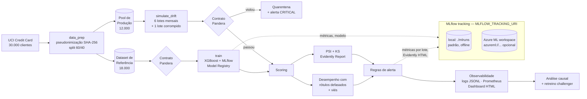
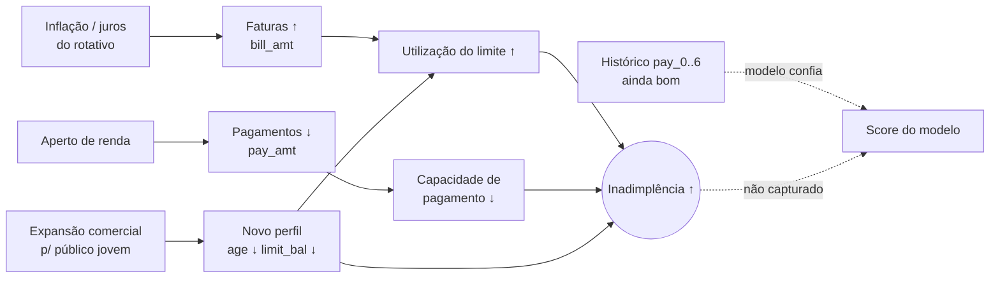

# Tech Challenge — Fase 4 · Sustentação e Confiabilidade de um modelo de Credit Scoring

> Observabilidade contínua, detecção de drift, qualidade de dados e governança (LGPD) para um modelo de crédito em produção.

**Grupo:** Ahmed Mohamad Bakri · Leandro Feitosa da Silva · Luiz Fernando Carvalho · **Vídeo STAR:** https://youtu.be/vfAA_kybjks

Uma fintech tem um modelo de Credit Scoring em produção e suspeita de **degradação silenciosa** após mudanças na economia (inflação, novos perfis de clientes). Este repositório constrói a camada que intercepta dados ruins, detecta o drift, explica a causa e documenta a governança.

| Entregável | Onde está |
|---|---|
| Contrato de dados (Pandera) + bloqueio de lote ruim | [src/contracts.py](src/contracts.py), [src/validate.py](src/validate.py) |
| Modelo baseline treinado (XGBoost) | [src/train.py](src/train.py), [reports/baseline_model_card.json](reports/baseline_model_card.json) |
| Simulação de Data Drift e Concept Drift | [src/simulate_drift.py](src/simulate_drift.py) |
| Detecção estatística (PSI + Kolmogorov-Smirnov) e relatórios Evidently | [src/monitor.py](src/monitor.py), [reports/evidently/](reports/evidently/) |
| Dashboard de observabilidade, logs, MLflow e Prometheus | [reports/dashboard.html](reports/dashboard.html), [reports/logs/](reports/logs/), [reports/metrics.prom](reports/metrics.prom) |
| Análise causal + prescrição | [src/causal_analysis.py](src/causal_analysis.py), [reports/causal_analysis.json](reports/causal_analysis.json) |
| Governança e LGPD | [seção 7 deste README](#7-governança-e-lgpd-etapa-4) |
| Vídeo STAR | [youtu.be/vfAA_kybjks](https://youtu.be/vfAA_kybjks) · [seção 9](#9-vídeo-star) · roteiro em [docs/roteiro_video.md](docs/roteiro_video.md) |
| Tracking no Azure ML (opcional) | [src/tracking.py](src/tracking.py), [docs/azure_setup.md](docs/azure_setup.md) |

---

## 1. Arquitetura



O código **sempre roda localmente**. Só o *destino* do tracking muda: com `MLFLOW_TRACKING_URI` definida (no ambiente ou no `.env`), runs, métricas e artefatos vão para o workspace do Azure ML. Sem a variável, ficam em `./mlruns`. Nenhum Compute, Cluster ou Endpoint é criado no Azure.

**Separação Referência x Produção** (boa prática obrigatória): o dataset é dividido **uma única vez**, de forma estratificada, em
- **Referência (60%, 18.000 linhas):** único dado usado para treinar, validar e escolher o limiar do modelo (70/15/15). O holdout de 15% (2.700 linhas, nunca visto no treino) é a referência de comparação do monitoramento, o que evita métricas otimistas.
- **Produção (40%, 12.000 linhas):** o modelo nunca vê esses dados. Eles são fatiados em 6 lotes mensais (mai/2026 → out/2026), e é neles que o drift é simulado.

## 2. Como executar

### Local (padrão, 100% offline)

```bash
python -m venv .venv
.venv\Scripts\activate            # Linux/Mac: source .venv/bin/activate
pip install -r requirements.txt

python main.py                    # comando único (~1 min): baixa os dados, treina, simula, monitora, gera relatórios
pytest -q                         # 20 testes: regras do contrato, PSI/KS, tracking URI
mlflow ui --backend-store-uri sqlite:///mlruns/mlflow.db   # http://127.0.0.1:5000
```

Depois de rodar, abra **`reports/dashboard.html`** no navegador. Os relatórios Evidently de cada lote ficam em `reports/evidently/`.

Para demonstrar só o contrato bloqueando um lote (útil no vídeo):

```bash
python -m src.validate "data/production/2026-08_sistema_legado.csv"   # código de saída 1, lista as violações por regra
python -m src.validate "data/production/2026-05.csv"                  # OK
```

### Azure ML como servidor de tracking (opcional)

```bash
pip install -r requirements.txt -r requirements-azure.txt
az login                                   # autenticação via DefaultAzureCredential
copy .env.example .env                     # preencha AZURE_* e MLFLOW_TRACKING_URI (azureml://...)
python -m src.tracking                     # confere o destino: "azureml: azureml://..."
python main.py                             # mesmo comando; o tracking vai para o workspace
```

Criação do workspace, orçamento com alerta e remoção de tudo: **[docs/azure_setup.md](docs/azure_setup.md)**. O `.env` está no `.gitignore` e nunca deve ser versionado.

| | Local | Azure ML |
|---|---|---|
| Onde o código roda | sua máquina | sua máquina |
| Tracking | `sqlite:///mlruns/mlflow.db` + `mlruns/artifacts` | workspace (`azureml://...`) |
| Visualização | `mlflow ui` | ml.azure.com → Jobs / Models |
| Dependências extras | — | `requirements-azure.txt` |
| Dados de clientes | local | **continuam locais**; só métricas e relatórios agregados sobem |

```
├── main.py                    # comando único: pipeline ponta a ponta
├── src/
│   ├── config.py              # caminhos, features, limiares de alerta
│   ├── tracking.py            # MLflow: MLFLOW_TRACKING_URI (Azure ML) ou ./mlruns
│   ├── data_prep.py           # download, pseudonimização, split referência/produção
│   ├── contracts.py           # contrato de dados (Pandera) — 9 regras rígidas
│   ├── validate.py            # validação, bloqueio e quarentena
│   ├── train.py               # XGBoost baseline + MLflow + model card
│   ├── simulate_drift.py      # data drift + concept drift + lote corrompido
│   ├── metrics.py             # AUC/KS/recall, PSI, teste KS, fairness
│   ├── monitor.py             # monitoramento por lote + Evidently + alertas + MLflow
│   ├── causal_analysis.py     # intervenções contrafactuais + challenger
│   ├── dashboard.py           # dashboard HTML + Prometheus
│   └── logging_utils.py       # logs estruturados JSONL e alertas
├── tests/                     # pytest
├── reports/                   # evidências geradas (versionadas)
├── docs/azure_setup.md        # comandos az CLI (workspace, budget, remoção)
├── docs/roteiro_video.md      # roteiro STAR
├── .env.example               # variáveis do Azure (copiar para .env)
├── requirements.txt           # execução local
└── requirements-azure.txt     # opcional: tracking no Azure ML
```

**Dataset:** [UCI Default of Credit Card Clients](https://archive.ics.uci.edu/dataset/350) (30.000 clientes, classificação binária de inadimplência, licença CC BY 4.0). Ele atende ao mínimo de 5.000 amostras e é baixado automaticamente, sem necessidade de login. Para o exercício, tratamos os registros como se fossem clientes brasileiros da fintech.

---

## 3. Etapa 1 — Validação de dados e contratos

**Modelo baseline.** XGBoost (300 árvores, profundidade 4) treinado só com o Dataset de Referência, **depois** de o próprio dataset passar pelo contrato. O limiar foi escolhido na validação, maximizando o F1: `aprovar se P(default) < 0,35`. Tudo fica registrado no MLflow, e o modelo vai para o Model Registry como `credit-scoring-xgb` v1.

| Métrica (holdout) | Valor |
|---|---|
| AUC | **0,784** |
| Gini | 0,568 |
| KS (separação bons × maus) | 0,436 |
| Recall de inadimplentes | 0,496 |
| Taxa de aprovação | 81,4% |

**Contrato de dados `CreditContract v1.0`** ([src/contracts.py](src/contracts.py)), avaliado com `lazy=True` para reportar **todas** as violações de uma vez:

| # | Regra rígida | Exemplo do que bloqueia |
|---|---|---|
| R1 | `client_hash` obrigatório e **único** | cliente duplicado |
| R2 | `limit_bal` (limite/renda) **não nulo** e em (0; 1.000.000] | renda nula, limite negativo |
| R3 | **idade entre 18 e 100** | menor de idade, idade 150 |
| R4 | categorias válidas: `education` ∈ {1..4}, `sex` ∈ {1,2}, `marriage` ∈ {1,2,3} | escolaridade 7 |
| R5 | status de pagamento `pay_*` ∈ [-2; 8] | código 99 |
| R6 | valores monetários em faixas plausíveis; pagamentos ≥ 0 | pagamento −1.500 |
| R7 | alvo binário | — |
| R8 | sem linhas duplicadas e **esquema estrito** | coluna `cpf` inesperada (**PII bloqueada por design**) |
| R9 | lote não vazio | arquivo vazio |

**Demonstração do bloqueio.** O lote `2026-08_sistema_legado` simula uma integração com bugs vinda de um sistema legado. Ele é **bloqueado antes do scoring**: nenhuma predição é gerada, o arquivo vai para `data/quarantine/` junto com um JSON de violações, e um alerta `DATA_CONTRACT_VIOLATION` (CRITICAL) é disparado. As 9 violações detectadas:

| Coluna | Regra violada | Casos |
|---|---|---|
| `limit_bal` | not_nullable | 45 |
| `client_hash` | field_uniqueness | 40 |
| `age` | ≥ 18 / ≤ 100 | 11 + 4 |
| `pay_amt1` | ≥ 0 | 10 |
| `education` | isin [1,2,3,4] | 5 |
| `pay_0` | ≤ 8 | 5 |
| (dataset) | column_in_schema → `cpf` | 1 |
| (dataset) | linhas duplicadas | 20 |

Cada regra também tem um teste automatizado isolado em [tests/test_contracts.py](tests/test_contracts.py), executado na CI (GitHub Actions).

---

## 4. Etapa 2 — Simulação e detecção de drift

### Cenário simulado ([src/simulate_drift.py](src/simulate_drift.py))

São 6 lotes mensais de 2.000 clientes, com a intensidade do drift crescendo linearmente (mai = 0 → out = 1). O primeiro mês não tem drift e serve como **grupo de controle**.

| Tipo | Mudança | Variáveis afetadas | Intensidade máxima |
|---|---|---|---|
| **Data drift** D1 | Inflação + juros do rotativo elevam as faturas | `bill_amt1..6` | +80% |
| **Data drift** D2 | Aperto de renda reduz pagamentos | `pay_amt1..6` | −40% |
| **Data drift** D3 | Novo perfil: jovens de 21–27 anos com limite de R$ 10k–50k | `age`, `limit_bal` | 40% do lote |
| **Concept drift** C1 | Clientes com utilização > 50% passam a inadimplir mais, **mesmo com bom histórico** | P(y \| X) | +30 p.p. |
| **Concept drift** C2 | O novo perfil jovem tem inadimplência estruturalmente maior | P(y \| X) | +25 p.p. |

Os rótulos de inadimplência chegam com defasagem (em crédito, normalmente 30 a 90 dias). A simulação supõe que eles já estejam disponíveis no fechamento de cada lote, o que permite medir o concept drift.

### Detecção

Para cada lote, as **22 variáveis** (21 features + o score do modelo) passam por dois testes:
- **PSI** (Population Stability Index) com bins por decis da referência. Faixas: < 0,10 estável, 0,10–0,20 atenção, ≥ 0,20 **drift**.
- **Kolmogorov-Smirnov** de duas amostras (estatística + p-valor).
- **Evidently AI 0.7** (`DataDriftPreset` com PSI, `ValueDrift` com KS nas variáveis-chave, `ClassificationPreset` para a qualidade do modelo) gera um relatório HTML interativo por lote: [reports/evidently/](reports/evidently/).

### Resultado — último lote (2026-10)

| Variável | PSI | KS | p-valor KS | Status |
|---|---|---|---|---|
| `age` | **0,394** | 0,288 | 1,6e-84 | **drift** |
| score do modelo | **0,336** | 0,252 | ≈ 0 | **drift** |
| `limit_bal` | **0,310** | 0,260 | 1,7e-68 | **drift** |
| `pay_amt1` | **0,276** | 0,218 | 3,2e-48 | **drift** |
| `pay_amt2` | 0,186 | 0,209 | 1,4e-44 | atenção |
| `bill_amt1` | 0,169 | 0,167 | 2,0e-28 | atenção |
| `pay_0..pay_6` | ≤ 0,01 | — | — | estável |

O Evidently chega ao mesmo diagnóstico (age 0,41 · score 0,34 · limit_bal 0,22). Variáveis de histórico de pagamento, como `pay_0`, ficaram **estáveis**. Isso é o que torna a degradação silenciosa: a variável mais importante do modelo não mudou, mas o que ela significa mudou.

### Evolução mês a mês

| Lote | Status | AUC | Inadimplência real | Aprovação | Maior PSI | Features com drift |
|---|---|---|---|---|---|---|
| 2026-05 | ✓ saudável | 0,767 | 22,7% | 81,9% | 0,01 | 0 |
| 2026-06 | ✓ saudável | 0,760 | 25,9% | 81,6% | 0,06 | 0 |
| 2026-07 | ! atenção | 0,758 | 27,3% | 78,4% | 0,14 | 0 (4 em atenção) |
| 2026-08 | ▲ alerta | 0,708 | 30,8% | 77,6% | 0,24 | 2 |
| 2026-08 legado | ⛔ bloqueado | — | — | — | — | — |
| 2026-09 | ▲ alerta | 0,700 | 37,4% | 78,0% | 0,35 | 3 |
| 2026-10 | ▲ alerta | **0,693** | **41,7%** | 76,1% | 0,39 | 3 |

A inadimplência quase **dobra** (22% → 42%) enquanto a taxa de aprovação cai só cerca de 5 p.p. Ou seja, o modelo continua aprovando quase o mesmo volume de clientes, mas agora aprova clientes piores.

---

## 5. Etapa 3 — Observabilidade de pipelines e modelos

Três camadas complementares recebem os mesmos eventos:

1. **Logs estruturados centralizados** (JSON Lines): `logs/pipeline.jsonl` guarda cada etapa de cada lote (status, latência, volume) e `logs/alerts.jsonl` guarda os alertas. Uma cópia fica versionada em [reports/logs/](reports/logs/). Os logs **nunca contêm dados pessoais**, apenas contagens, métricas e nomes de lote.
2. **MLflow** (local em `./mlruns` ou Azure ML, via `MLFLOW_TRACKING_URI`; ver [seção 2](#2-como-executar)):
   - experimento `credit-scoring-training`: parâmetros, métricas, modelo registrado e model card;
   - experimento `credit-scoring-monitoring`: um run pai com **séries temporais por lote** (gráficos de AUC, PSI e drift share por step) e um run filho por lote, com o HTML do Evidently, a tabela de drift ou as violações do contrato como artefatos. Ao final, o dashboard, os logs, o resumo e a análise causal são anexados ao run pai.

   O que é registrado em **cada execução** de `python main.py`:

   | Grupo | Métricas / artefatos no MLflow |
   |---|---|
   | Modelo (treino) | parâmetros do XGBoost, limiar; `holdout_auc`, `holdout_f1`, `holdout_precision`, `holdout_recall`, `holdout_ks_score`, `holdout_gini`; impacto desproporcional; modelo registrado `credit-scoring-xgb` |
   | Validação | `validation_passed` (1/0), `contract_violations_total`, `contract_R1_cases` … `contract_R9_cases` (casos por regra); também para o dataset de referência (`reference_contract_*`) |
   | Drift por feature | `psi_<feature>`, `ks_stat_<feature>`, `ks_pvalue_<feature>`, `drift_flag_<feature>` (22 variáveis), `drift_share`, `n_drifted_features`, `max_psi`, `evidently_drifted_columns` |
   | Modelo em produção | `auc`, `f1`, `precision`, `recall`, `ks_score`, `approval_rate`, `default_rate_observed` |
   | Alertas | `alerts_total`, `alerts_critical`, `alerts_drift`, `alerts_contract`, `alerts_other`; agregados `run_alerts_*` |
   | Pipeline | `pipeline_success`, `rows_received`, `rows_scored`, `throughput_rows_s`, `latency_total_s`, `latency_<etapa>_s` |
   | Artefatos | `evidently/drift_report_<lote>.html`, `feature_drift.json`, `predictions_summary.json`, `contract_violations.json`, `reports/dashboard.html`, `logs/*.jsonl` |

   As predições individuais de cada lote ficam em `data/predictions/<lote>.csv` (com `client_hash`, score e decisão). Esse arquivo é local e nunca é versionado nem enviado à nuvem; para o MLflow vai apenas um resumo (taxa de aprovação e quantis do score).
3. **Dashboard HTML autocontido** ([reports/dashboard.html](reports/dashboard.html)) com KPIs, AUC no tempo, inadimplência × aprovação, heatmap de PSI por variável e mês, saúde do pipeline por etapa, violações do contrato, lista de alertas e análise causal. Há também uma exportação no formato **Prometheus** ([reports/metrics.prom](reports/metrics.prom)), pronta para o *textfile collector* do node_exporter (integração com a Fase 3).

### Métricas de saúde documentadas

| Grupo | Métrica | Fonte | Limiar / alerta |
|---|---|---|---|
| Pipeline | `pipeline_success` (status da execução por lote) | logs, MLflow, Prometheus | 0 → `DATA_CONTRACT_VIOLATION` (CRITICAL) |
| Pipeline | latência por etapa e total (s) | logs, dashboard | acompanhamento (~5 s/lote, dominado pelo Evidently) |
| Pipeline | volume: linhas recebidas × pontuadas | logs, MLflow, Prometheus | divergência indica bloqueio/perda |
| Pipeline | violações de contrato por regra | quarentena JSON, MLflow | qualquer violação bloqueia o lote |
| Dados | PSI por feature | MLflow `psi_<feature>` | ≥ 0,10 atenção · ≥ 0,20 `DATA_DRIFT` (CRITICAL) |
| Dados | KS (estatística, p-valor) | Evidently, dashboard | p < 0,05 e KS ≥ 0,10 → atenção |
| Dados | drift share (% de features com drift) | MLflow, Evidently | ≥ 30% → `DATASET_DRIFT` |
| Modelo | PSI do score (prediction drift) | MLflow | ≥ 0,10 → `PREDICTION_DRIFT` (WARNING) |
| Modelo | AUC, KS, recall, precisão (rótulos defasados) | MLflow, Evidently | queda de AUC ≥ 0,05 → `CONCEPT_DRIFT` (CRITICAL) |
| Negócio | taxa de inadimplência observada | MLflow | +5 p.p. vs treino → `DEFAULT_RATE_SHIFT` |
| Negócio | taxa de aprovação | MLflow, Prometheus | ±10 p.p. → `APPROVAL_RATE_SHIFT` |
| Ética | impacto desproporcional (sexo, faixa etária) | dashboard, `monitoring_summary.json` | < 0,80 → `FAIRNESS` |

**Resultado:** 14 alertas no total, 7 deles críticos. Os primeiros sinais aparecem em 2026-07 (aumento da inadimplência), e a partir de 2026-08 disparam alertas críticos de data drift e concept drift em todos os lotes.

---

## 6. Análise causal

### Modelo causal do problema



O modelo aprendeu que **histórico de pagamento bom implica baixo risco** (`pay_0` e `pay_2` respondem por 52% da importância). O choque econômico atua **antes** de o histórico se deteriorar: a utilização do limite sobe e a capacidade de pagamento cai. Por isso o modelo continua aprovando clientes que vão inadimplir. É um caso de **concept drift**, em que P(inadimplência | histórico) mudou, somado a **covariate shift** (novo perfil, faturas e pagamentos).

### Experimento de intervenção (contrafactual)

Como a degradação foi simulada, aplicamos intervenções no **mesmo lote de clientes** de 2026-10 e isolamos cada causa ([reports/causal_analysis.json](reports/causal_analysis.json)):

| Cenário | AUC | Recall | Aprovação | Inadimplentes entre aprovados |
|---|---|---|---|---|
| A · sem drift (economia estável) | 0,772 | 0,463 | 82,4% | 14,8% |
| B · só data drift — do(X′) | 0,742 | 0,518 | 76,1% | 14,4% |
| C · só concept drift — do(y\|X)′ | 0,732 | 0,385 | 82,4% | 22,1% |
| D · data + concept (realidade) | **0,693** | 0,386 | 76,1% | **33,7%** |

- **Data drift sozinho** tira 0,030 de AUC, mas **não aumenta o risco aprovado**: o modelo reage ao perfil novo e aprova menos.
- **Concept drift sozinho** tira 0,040 de AUC e aumenta a inadimplência entre aprovados de 14,8% para 22,1%, **sem mudar a taxa de aprovação**. Esse é o componente silencioso, invisível em qualquer monitor que olhe apenas P(X).
- **Juntos**, os dois se reforçam: um em cada três clientes aprovados vira inadimplente.

**Por segmento** (cenário real), a degradação se concentra no **novo perfil jovem com limite baixo** (inadimplência de 54,8%, AUC 0,62) e nos clientes com **utilização > 50%** (53,0%, AUC 0,63). A carteira tradicional mantém AUC 0,71.

### Prescrição

| Ação | Gatilho | Evidência |
|---|---|---|
| **Retreino (challenger)** com dados recentes rotulados | `CONCEPT_DRIFT` em 2 lotes seguidos | challenger v2 (referência + 2026-08/09): AUC 0,693 → **0,718**, recall 0,386 → **0,629**, inadimplentes entre aprovados 33,7% → **28,1%** |
| Nova feature `utilizacao = bill_amt1 / limit_bal` | causa identificada no DAG | o segmento de alta utilização concentra o erro |
| Política específica para o novo perfil (limite inicial menor, segmentação) | AUC 0,62 no segmento | decisão de negócio, não só de modelo |
| Promoção do challenger **somente** após shadow mode, avaliação de viés e aprovação do comitê de risco | governança (seção 7) | o challenger aprova menos (55%); o impacto comercial precisa ser validado |

---

## 7. Governança e LGPD (Etapa 4)

### 7.1 Inventário e classificação dos dados

| Dado | Classificação LGPD | Tratamento neste projeto |
|---|---|---|
| ID do cliente (original) | dado pessoal identificador | **removido** na ingestão e substituído por `client_hash` = SHA-256(salt + ID), truncado a 16 hex. É **pseudonimização** (art. 13, §4º); o salt fica fora do repositório (variável `PSEUDO_SALT` / cofre de segredos) |
| CPF, nome, endereço, telefone | dado pessoal | **não trafegam**: o contrato é estrito e rejeita qualquer coluna fora do esquema (regra R8) |
| `sex`, `marriage` | dado pessoal (não sensível pelo art. 5º, II), mas **atributo protegido contra discriminação** | **excluídos das features do modelo**; mantidos apenas para auditoria de viés |
| `age` | dado pessoal | usado como feature, com justificativa de risco e monitoramento de impacto por faixa etária |
| limite, faturas, pagamentos, histórico | dados financeiros pessoais | usados para a finalidade de análise de crédito |
| Logs, dashboard, MLflow | — | contêm **apenas agregados** (contagens, métricas), nunca registros individuais |

Nenhum **dado pessoal sensível** (art. 5º, II: origem racial, saúde, biometria etc.) é coletado ou inferido.

### 7.2 Base legal

| Tratamento | Base legal (LGPD, art. 7º) |
|---|---|
| Análise de risco e decisão de concessão | **inc. X — proteção do crédito** e **inc. V — procedimentos preliminares/execução de contrato** a pedido do titular |
| Monitoramento do modelo (drift, desempenho, viés) | **inc. IX — legítimo interesse** (segurança e qualidade da decisão de crédito), com teste de balanceamento documentado e dados pseudonimizados |
| Guarda de histórico para obrigações regulatórias | **inc. II — cumprimento de obrigação legal/regulatória** |

**Não usamos consentimento** como base para a decisão de crédito. Como a concessão depende do tratamento, o consentimento não seria livre, e a base de proteção do crédito é a mais adequada.

### 7.3 Princípios aplicados (art. 6º) — Privacy by Design e by Default

| Princípio | Implementação |
|---|---|
| Finalidade e adequação | dados usados exclusivamente para risco de crédito |
| **Necessidade (minimização)** | ID removido; atributos protegidos fora do modelo; esquema estrito impede colunas extras |
| Qualidade dos dados | contrato Pandera com 9 regras rígidas e quarentena |
| **Não discriminação** | sexo e estado civil fora do modelo; monitoramento de impacto desproporcional por lote |
| Transparência | model card versionado, documentação de features e limiar |
| Segurança e prevenção (art. 46) | pseudonimização, dados fora do Git (`.gitignore`), salt em cofre, logs sem PII |
| Responsabilização (art. 37) | rastreabilidade completa no MLflow: qual dado (hash do dataset de referência), qual modelo e qual limiar geraram cada decisão |

**By default:** a configuração padrão é a mais restritiva. Colunas desconhecidas são bloqueadas, lotes inválidos vão para a quarentena e os painéis só mostram agregados.

### 7.4 Decisão automatizada e explicabilidade (art. 20)

- O titular tem direito de **solicitar a revisão** de uma decisão tomada unicamente com base em tratamento automatizado. Recusas devem ter um canal de revisão humana por analista de crédito.
- Devem ser fornecidas **informações claras sobre os critérios** usados (art. 20, §1º). O model card publica as features e suas importâncias (histórico de pagamento recente, limite, faturas, pagamentos), e a recomendação é gerar *reason codes* individuais (SHAP) na resposta de recusa.
- A instituição pode alegar segredo comercial sobre o algoritmo, mas isso não afasta a auditoria da ANPD (art. 20, §2º).

### 7.5 Viés e mitigação

| Grupo | Impacto desproporcional — baseline | Último lote | Limite |
|---|---|---|---|
| Sexo (aprovação F × M) | 0,93 | 0,98 | ≥ 0,80 |
| Faixa etária (18-25 / 26-35 / 36-50 / 51+) | 0,88 | 0,84 (mínimo de 0,82 em 2026-09) | ≥ 0,80 |

- **Mitigação aplicada:** remoção de atributos protegidos, limiar único para todos e monitoramento de impacto desproporcional a cada lote, com alerta `FAIRNESS`.
- **Risco aberto:** a idade é feature do modelo e o novo perfil é jovem. O impacto por faixa etária caiu de 0,88 para 0,82, perto do limite. Antes de promover o challenger, é preciso avaliar se `age` funciona como proxy discriminatório, comparando o desempenho com e sem `age` e as taxas de erro por faixa (*equalized odds*).

### 7.6 Plano de retenção

| Dado | Prazo | Fundamento | Ao fim do prazo |
|---|---|---|---|
| Dados da proposta de clientes **não contratados** | 6 meses | necessidade (art. 6º, III); defesa em eventual revisão (art. 20) | eliminação (art. 16) |
| Dados cadastrais e financeiros de clientes **ativos** | durante o contrato + 5 anos | prescrição (CDC art. 27; CC art. 206) | eliminação ou anonimização |
| Histórico de adimplemento (Cadastro Positivo) | até 15 anos | Lei 12.414/2011, art. 14 | eliminação |
| Informações negativas | até 5 anos | CDC art. 43, §1º | eliminação |
| **Dataset de referência** do modelo | enquanto o modelo estiver em produção + 5 anos | auditoria e reprodutibilidade de decisões | anonimização |
| Lotes de produção e quarentena | 90 dias (quarentena) / 13 meses (produção, para comparar sazonalidade) | necessidade | eliminação automatizada |
| Logs de pipeline e métricas agregadas | 5 anos | responsabilização (art. 37) | não contêm PII |

### 7.7 Papéis e processos

- **Controlador:** a fintech. **Encarregado (DPO)** é o canal com titulares e com a ANPD (art. 41).
- **RIPD (Relatório de Impacto, art. 38):** obrigatório antes de promover qualquer nova versão do modelo, cobrindo as features, os resultados de viés e o drift.
- **Incidentes:** vazamento de dados pessoais deve ser comunicado à ANPD e aos titulares em prazo razoável (art. 48; Res. CD/ANPD nº 15/2024: 3 dias úteis).
- **Ciclo de vida do modelo:** champion em produção, challenger em *shadow mode*, comitê de risco, promoção no Model Registry do MLflow. Toda troca de modelo é rastreável.
- **Direitos do titular (art. 18):** o `client_hash` permite localizar, corrigir ou eliminar os registros de um titular pelo controlador (que detém o salt) sem expor o ID nos artefatos analíticos.

---

## 8. Lições aprendidas

1. **Monitorar só os dados de entrada não basta.** As variáveis mais importantes (`pay_0..6`) ficaram estáveis, e o concept drift só aparece com rótulos. É preciso monitorar desempenho com ground truth defasado e métricas de negócio (inadimplência entre aprovados).
2. **Taxa de aprovação estável não significa modelo saudável.** A aprovação caiu cerca de 5 p.p. enquanto a inadimplência dobrou.
3. **PSI depende do binning.** O Evidently usa bins de largura fixa e subestima o drift de variáveis monetárias com cauda longa. Usar PSI por decis junto com KS, e cruzar as duas fontes, deu um diagnóstico consistente.
4. **O contrato de dados é a primeira linha de defesa e também de privacidade.** O esquema estrito impediu um `cpf` de chegar ao modelo.
5. **Simular permite análise causal.** As intervenções separaram o efeito do covariate shift do efeito do concept drift e indicaram a prescrição certa: retreino com dados recentes e uma nova feature de utilização, não apenas recalibração.

## 9. Vídeo STAR

🎥 **Link do vídeo:** https://youtu.be/vfAA_kybjks

Roteiro de 5 minutos (Situation, Task, Action, Result) com falas e o que mostrar na tela: [docs/roteiro_video.md](docs/roteiro_video.md).

## 10. Limitações

- O drift é **simulado** sobre um dataset de 2005 (Taiwan). Os números ilustram o método, não a economia brasileira real.
- Os rótulos estão disponíveis no fechamento de cada lote. Na vida real, a defasagem de 30 a 90 dias atrasa o alerta de concept drift, e por isso os alertas de data drift e de prediction drift funcionam como sinais antecipados.
- O monitoramento roda em lote (batch). Em produção, ele seria agendado (Airflow/cron) e o `metrics.prom` seria lido por Prometheus/Grafana.
